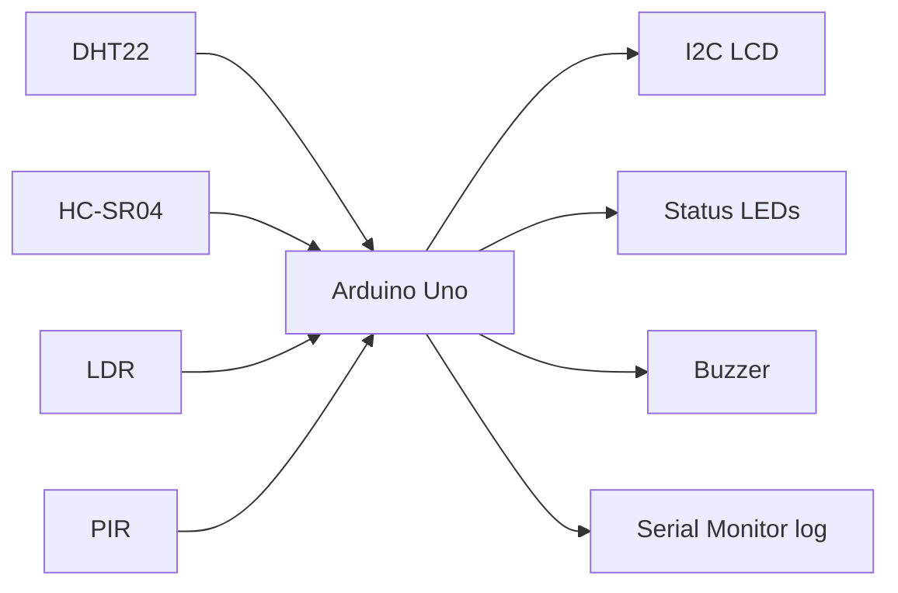

# System architecture

## Data flow
1. Every 2 seconds the Arduino reads the DHT22, HC-SR04, LDR and PIR.
2. `checkAlarm()` compares the readings with the thresholds and returns one alarm reason, or none.
3. The same result drives the LEDs, buzzer, LCD and Serial log, so all outputs always agree.

See also: `diagrams/block_diagram.png` and `diagrams/wiring_diagram.png`.
